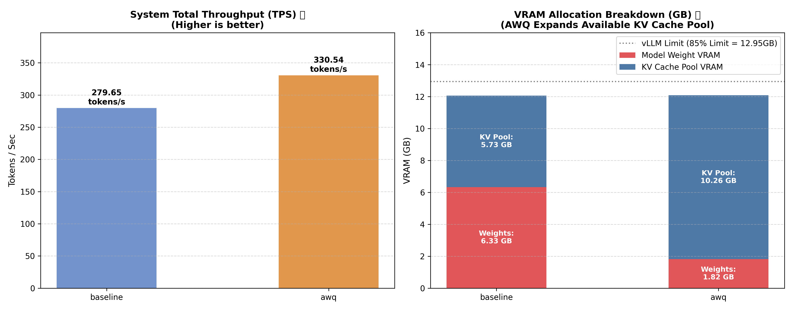
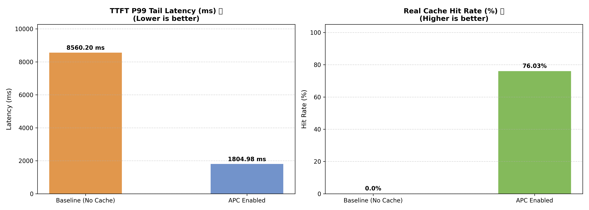

# 🚀 vLLM High-Performance LLM Inference & Serving Optimization

[](https://github.com/vllm-project/vllm)
[](https://huggingface.co/Qwen/Qwen2.5-3B-Instruct)
[](https://www.python.org/)

本專案針對大語言模型（LLM）在高併發、長上下文與重複前綴（RAG / Agent）等真實業務場景下的推論瓶頸，基於 **vLLM** 推論引擎進行實測與優化。透過**結構壓縮（AWQ Quantization）**、**動態排程管理（Chunked Prefill）**與**記憶體快取重用（Automatic Prefix Caching）**策略，全方位降低 VRAM 顯存佔用、提升系統整體吞吐量（System TPS），並顯著削減首字延遲（TTFT）。

---

## 📌 Executive Summary & Key Results

在固定硬體資源與 `Qwen2.5-3B-Instruct` 模型基礎上，階段性優化成果如下：

| 優化維度&nbsp;&nbsp;&nbsp;&nbsp;&nbsp;&nbsp;&nbsp;&nbsp; | 核心技術 | 關鍵優化數據 | 價值與效益 |
| :--- | :--- | :--- | :--- |
| **結構壓縮**<br>(Day 1) | **AWQ 4-bit 量化** | • **模型顯存**：6.33 GB → 1.82 GB **(-71.2%)** <br>• **KV Cache 池**：5.73 GB → 10.26 GB **(+79.1%)** <br>• **系統 TPS**：279.65 → 330.54 **(+18.2%)** | 大幅舒緩 GPU 記憶體頻寬限制，在相同顯存預算下釋放更多空間給 PagedAttention 動態分配 KV Cache。 |
| **動態排程**<br>(Day 2) | **Chunked Prefill** | • **16K ITL**：231.45 ms → 224.42 ms **(-3.0%)** <br>• **16K 總延遲**：237.01 s → 229.80 s **(-3.0%)** | 將長 Prompt 在 Prefill 階段分塊（`max_num_batched_tokens=2048`），避免巨額預填運算阻塞 Decode 步驟。 |
| **記憶體管理**<br>(Day 3) | **Automatic Prefix Caching (APC)** | • **平均 TTFT**：7388.60 ms → 827.25 ms **(-88.8%)** <br>• **P99 TTFT**：8560.20 ms → 1804.98 ms **(-78.9%)** <br>• **快取命中率**：0.0% → 76.03% **(+76.03%)** | 採用 Radix Tree 區塊雜湊重用重複前綴（如 System Prompt / RAG Context），實現首字反應時間降低 8.9 倍。 |

---

## 📊 Benchmark Deep-Dives & Technical Insights

### Phase 1: 權重壓縮 —— AWQ 4-bit 量化 (Structural Compression)

#### 實驗目的
模型推論在 Decode 階段通常受到 **Memory Bandwidth Bound（記憶體頻寬瓶頸）** 限制。本實驗旨在驗證透過 AWQ (Activation-aware Weight Quantization) 4-bit 權重壓縮，能否大幅削減靜態模型顯存佔用，並將釋放出的顯存最大化提供給 PagedAttention 記憶體池以提高高併發下的系統吞吐量。

#### 實測數據對照 (`Concurrency = 30`)

| 測試指標 | FP16 Baseline | AWQ 4-bit 優化組 | 變化幅度 |
| :--- | :---: | :---: | :---: |
| **Model Weight VRAM (GB)** | `6.33` | **`1.82`** | 📉 **-71.2%** |
| **KV Cache Pool VRAM (GB)** | `5.73` | **`10.26`** | 📈 **+79.1%** |
| **Total Reserved VRAM (GB)** | `12.06` | `12.08` | 持平 (固定 85% VRAM) |
| **Total Execution Time (sec)** | `53.53` | **`45.21`** | ⚡ **-15.5%** |
| **Total Generated Tokens** | `14,969` | `14,943` | - |
| **System Throughput (TPS)** | `279.65` | **`330.54`** | 🚀 **+18.2%** |

#### 結果圖表


#### 核心技術洞察
1. **顯存結構轉向**：AWQ 將模型權重從 `6.33 GB` 劇降至 `1.82 GB`。在相同的 GPU VRAM 預留上限（~12 GB）下，PagedAttention 可用的 KV Cache Pool 空間從 `5.73 GB` 提升至 `10.26 GB`。
2. **頻寬解套與吞吐量爆發**：權重體積大幅縮小意味著 GPU 每步 Decode 載入權重的頻寬需求減少，進而使 Concurrent = 30 的系統總吞吐量提升了 **18.2%**。

---

### Phase 2: 分段預填 —— Chunked Prefill (Memory Scheduling)

#### 實驗目的
長上下文場景（如文檔分析、長對話歷史）中，Prefill 階段需一次性處理數萬 Tokens 的 Prompt 計算，這會造成 GPU 算力尖峰並嚴重阻塞其他請求的 Decode 步驟（導致 Inter-Token Latency, ITL 暴增）。本實驗導入 **Chunked Prefill** 策略（設定 `prefill_step_max_tokens = 2048`），驗證其對長文本平滑度與延遲的控制能力。

#### 跨 Prompt 長度梯度實測數據 (`2K` 至 `16K`)

| Prompt 梯度 | 評測模式 | Total Prompt Tokens | Total Gen Tokens | Decode TPS | ITL (ms) | Total Latency (s) |
| :---: | :--- | :---: | :---: | :---: | :---: | :---: |
| **2K** | Baseline | 8,856 | 1,024 | 57.83 | 17.29 | 17.71 |
| | **Chunked Prefill** | 8,856 | 1,024 | **58.12** | **17.21** | **17.62** |
| **4K** | Baseline | 17,584 | 1,024 | 34.63 | 28.87 | 29.57 |
| | **Chunked Prefill** | 17,584 | 1,024 | **35.38** | **28.26** | **28.94** |
| **8K** | Baseline | 34,193 | 1,024 | 14.35 | 69.70 | 71.37 |
| | **Chunked Prefill** | 34,193 | 1,024 | 13.99 | 71.47 | 73.18 |
| **16K** | Baseline | 68,576 | 1,024 | 4.32 | 231.45 | 237.01 |
| | **Chunked Prefill** | 68,576 | 1,024 | **4.46** | **224.42** | **229.80** |

#### 結果圖表


#### 核心技術洞察
1. **算力尖峰切片**：在極長 Prompt（68,576 Prompt Tokens）情境下，傳統 Prefill 一次性載入造成嚴重的執行阻斷；啟用 Chunked Prefill 後將單步預填上限制於 2048 tokens，成功降低了逐字生成延遲（ITL 從 `231.45 ms` 降至 `224.42 ms`）。
2. **極致穩定性**：在小併發長文本情境下，分段 Prefill 保障了運算資源的均勻分配，使總執行時間減少約 `7.21 秒`。

---

### Phase 3: 快取重用 —— Automatic Prefix Caching (APC)

#### 實驗目的
在 Agent 多輪對話、固定 System Prompt 以及 RAG 檢索生成等業務場景中，請求通常包含大量高度重複的前綴（System Prompt / Context）。本實驗透過啟用 vLLM 的 **Automatic Prefix Caching (APC)**，驗證基於 Radix Tree 的 KV Cache 共享機制對首字延遲（TTFT）與尾端延遲（P99 TTFT）的優化幅度。

#### 實測數據對照 (5 個請求，包含共用前綴)

| 評測指標 | Baseline (APC Off) | APC Enabled (Optimized) | 差異與優化比率 |
| :--- | :---: | :---: | :---: |
| **Average TTFT (ms)** | `7388.60` | **`827.25`** | ⚡ **-88.8% (8.9x Faster)** |
| **P99 TTFT (ms)** | `8560.20` | **`1804.98`** | 📉 **-78.9%** |
| **Cache Hits Count** | `0` | **`8,512`** | - |
| **Cache Queries Count** | `0` | `11,196` | - |
| **Prefix Cache Hit Rate (%)**| `0.0%` | **`76.03%`** | 📈 **+76.03%** |

#### 結果圖表


#### 核心技術洞察
1. **Prefill 計算完全 Skip**：當重複前綴請求到達時，vLLM 的 Radix Tree 機制識別出前綴 Block-level Hash 完全相同，直接從 PagedAttention 記憶體中取得 KV Cache，完全跳過 $O(N^2)$ 的 Self-Attention 矩陣計算。
2. **用戶體驗突破**：在包含長前綴的情境下，平均首字反應時間由近 **7.4 秒暴降至 0.82 秒**，顯著提升了即時交互對話的用戶體感。

---

## 📂 Project Structure

[cite: 1]
```text
vllm-inference-optimization/
├── README.md                          # 專案總結與 Benchmark 數據分析報告
├── requirements.txt                   # 專案套件依賴 (vllm, torch, pandas, matplotlib 等)
├── configs/                           # 配置文件目錄
│   ├── day1_awq.yaml                  # Day 1: AWQ 量化與併發參數
│   ├── day2_chunked_prefill.yaml      # Day 2: Chunked Prefill 長文本參數
│   └── day3_apc.yaml                  # Day 3: APC 多輪前綴測試參數
├── data/
│   └── prompts/
│       └── benchmark_prompts.json     # 評測用 Prompt 資料集
├── results/                           # 實驗數據與視覺化產出
│   ├── charts/                        # 自動生成的性能對比圖
│   │   ├── day1_awq_comparison.png
│   │   ├── day2_chunked_prefill_comparison.png
│   │   └── day3_apc_comparison.png
│   └── raw_logs/                      # 實測 JSON 原始數據日誌
│       ├── day1_baseline.json
│       ├── day1_awq.json
│       ├── day2_baseline.json
│       ├── day2_chunked_prefill.json
│       ├── day3_baseline.json
│       └── day3_apc.json
└── src/
    └── experiments/                   # 模組化執行腳本
        ├── day1_awq_runner.py
        ├── day2_chunked_prefill_runner.py
        └── day3_prefix_runner.py
```

---

## 🛠️ Environment & Setup

- **GPU Target**: NVIDIA GPU (e.g., T4 / L4 / A10G / A100)
- **LLM Engine**: vLLM `v0.6.0+`
- **Model**: `Qwen/Qwen2.5-3B-Instruct` / `Qwen/Qwen2.5-3B-Instruct-AWQ`
- **Dependencies**: `torch`, `vllm`, `transformers`, `pandas`, `matplotlib`

### Installation

```bash
git clone https://github.com/your-username/vllm-inference-optimization.git
cd vllm-inference-optimization
pip install -r requirements.txt
```

---

## 🚀 Reproducing Benchmarks

### Day 1: AWQ 4-bit Quantization

```bash
python src/experiments/day1_awq_runner.py --mode baseline --config configs/day1_awq.yaml
python src/experiments/day1_awq_runner.py --mode awq --config configs/day1_awq.yaml
```

### Day 2: Chunked Prefill

```bash
python src/experiments/day2_chunked_prefill_runner.py --mode baseline --config configs/day2_chunked_prefill.yaml
python src/experiments/day2_chunked_prefill_runner.py --mode chunked_prefill --config configs/day2_chunked_prefill.yaml
```

### Day 3: Automatic Prefix Caching (APC)
```bash
python src/experiments/day3_prefix_runner.py --mode baseline --config configs/day3_apc.yaml
python src/experiments/day3_prefix_runner.py --mode apc --config configs/day3_apc.yaml
```

---

## Future Work
- **Phase 5 (In Progress)**: Speculative Decoding（投機解碼）極限加速測試。
